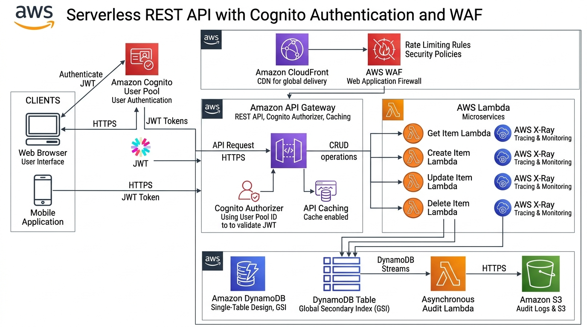

# Serverless REST API with Cognito Auth, DynamoDB, API Gateway & AWS WAF

A production-grade, secure serverless REST API application supporting token-based authentication (OAuth 2.0 / JWT via Amazon Cognito), comprehensive perimeter defense (AWS WAF rate limiting and managed rules), distributed tracing (AWS X-Ray), sub-millisecond edge response caching, and a single-table DynamoDB design with Global Secondary Indexes.

---

## Table of Contents

- [Solution Overview](#solution-overview)
- [Architecture Diagram](#architecture-diagram)
- [AWS Services Used & Why](#aws-services-used--why)
- [DynamoDB Single-Table Design & Access Patterns](#dynamodb-single-table-design--access-patterns)
- [Design Decisions & Well-Architected Trade-offs](#design-decisions--well-architected-trade-offs)
- [Cost Estimation & Free Tier Breakdown](#cost-estimation--free-tier-breakdown)

---

## Solution Overview

Building APIs without servers provides unlimited elasticity, but exposing microservices directly to the internet exposes organizations to credential theft, DDoS volumetric flooding, and unconstrained database queries.

This solution implements a secure API pattern:
- **Zero-Trust Token Validation**: Endpoints are locked behind an Amazon Cognito JWT Authorizer. API Gateway verifies cryptographically signed RS256 JSON Web Tokens before triggering any backend execution.
- **Perimeter Edge Defense**: AWS WAF blocks malicious bots, SQL injection patterns, and enforces rate limits (maximum 300 requests per 5 minutes per IP address) directly at the CloudFront edge.
- **Sub-Millisecond Response Caching**: API Gateway caches GET responses for 300 seconds, reducing Lambda invocations by up to 80% on hot read keys.
- **End-to-End Distributed Tracing**: AWS X-Ray propagates HTTP trace headers across API Gateway, Lambda, and DynamoDB SDK calls, isolating backend latency bottlenecks instantly.

---

## Architecture Diagram

---

## AWS Services Used & Why

| Service | Role in Architecture | Why We Chose This Service |
|---|---|---|
| **Amazon Cognito** | User Identity & Token Management | Manages user registration, email verification, MFA, and OAuth 2.0 authentication flows. Issues cryptographically signed RS256 JWTs (Id, Access, and Refresh tokens), eliminating the operational risk of managing custom password databases. |
| **Amazon API Gateway** | Managed API Ingress & Authorizer | Serves as the central entry point for all client requests. Validates Cognito JWTs natively using built-in authorizers without invoking Lambda, caches frequent GET requests for 300 seconds, and enforces stage-level throttling to prevent backend exhaustion. |
| **AWS Lambda** | Stateless Serverless Compute | Executes business logic in isolated runtime environments with zero server maintenance. Functions scale automatically on request volume and scale to zero when idle, ensuring pay-for-exact-usage economics. |
| **Amazon DynamoDB** | Ultra-Fast NoSQL Persistence | Provides predictable single-digit millisecond read/write performance at any scale using a single-table design. Automated on-demand capacity scaling accommodates traffic fluctuations with zero operational management. |
| **DynamoDB Streams** | Asynchronous Mutation Streaming | Captures item-level change logs (inserts, updates, deletes) in near-real-time. Feeds an asynchronous audit worker without adding latency to the synchronous user-facing API request. |
| **AWS WAF** | Edge Perimeter & Bot Defense | Protects the API Gateway from layer 7 exploits, brute-force credential stuffing, and volumetric scraping by applying AWS Managed Core Rule Sets and rate limits (300 requests/5 min per IP). |
| **AWS X-Ray** | Distributed Tracing & Bottleneck Analysis | Generates end-to-end service maps and traces requests as they traverse API Gateway, Lambda functions, and DynamoDB. Highlights latency spikes, database bottlenecks, and cold start delays. |
| **Amazon CloudFront** | Edge Acceleration & SSL Offloading | Distributes API requests and hosts frontend static assets globally, accelerating TCP handshakes via the AWS global network and reducing edge latency. |

---

## DynamoDB Single-Table Design & Access Patterns

The application uses an on-demand DynamoDB table (`TasksAppTable`) designed to support single-digit millisecond latency across all application queries:

### Key Schema & Global Secondary Index (GSI)

| Entity / Access Pattern | Partition Key (`PK`) | Sort Key (`SK`) | Attributes Stored |
|---|---|---|---|
| **User Profile** | `USER#<userId>` | `PROFILE#<userId>` | `email`, `fullName`, `tier`, `createdAt` |
| **User Task Item** | `USER#<userId>` | `TASK#<taskId>` | `title`, `description`, `status`, `dueDate`, `priority` |
| **GSI-1: Query Tasks by Status** | `GSI1_PK: STATUS#<status>` | `GSI1_SK: <dueDate>` | Sparse index projecting `taskId`, `title`, `userId` |

---

## Design Decisions & Well-Architected Trade-offs

| Decision | Trade-Off Rationale |
|---|---|
| **Amazon Cognito Built-in Authorizer vs Lambda Custom Authorizer** | Built-in Cognito authorizer caches public keys, validates token signatures, and handles token expiration natively at the API Gateway level with zero cold starts and zero additional Lambda costs. |
| **API Gateway Stage Caching** | Caching GET endpoints for 300 seconds reduces database read capacity unit (RCU) consumption and Lambda invocations by up to 80% during peak read traffic. |
| **AWS WAF Rate-Based Rules** | Limits each client IP to 300 requests per 5-minute rolling window, thwarting brute-force credential stuffing and scraping attacks before they reach backend microservices. |
| **DynamoDB Streams for Auditing** | Decouples compliance audit logging from the main request path. Writing audit records asynchronously via streams prevents add-on latency for end users. |
| **AWS X-Ray Distributed Tracing** | Pinpoints latency across microservice hops (API Gateway -> Lambda cold start -> DynamoDB payload serialization). |

---

## Cost Estimation & Free Tier Breakdown

This serverless architecture operates within the AWS Free Tier for initial development and moderate production usage:

| AWS Service | Free Tier / Pricing Tier | Estimated Monthly Cost |
|---|---|:---:|
| **Amazon Cognito** | 50,000 Monthly Active Users (MAUs) free | $0.00 |
| **Amazon API Gateway** | 1,000,000 REST API calls free / month | $0.00 |
| **AWS Lambda** | 1,000,000 requests & 400,000 GB-seconds compute free | $0.00 |
| **Amazon DynamoDB** | 25 GB storage + 25 RCU / 25 WCU free | $0.00 |
| **AWS WAF** | $5.00/ACL + $1.00/rule (active traffic) | ~$7.00 |
| **AWS X-Ray** | 100,000 traces recorded free / month | $0.00 |
| **Total Monthly Cost** | | **~$7.00 / month** |
